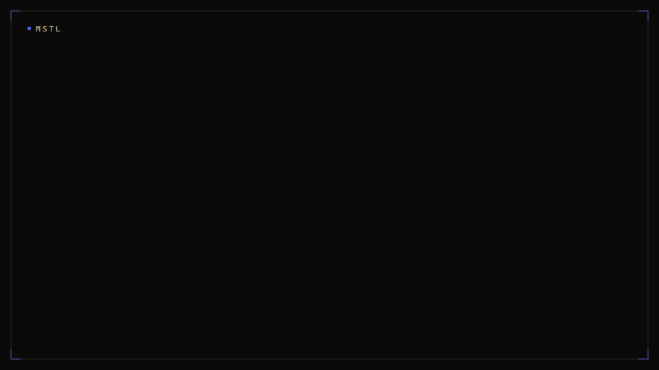

# MSTL — Minecraft Terminal Server Launcher

**English** | [简体中文](README.md)

A one-file server tool for people who run their own Minecraft server: double-click the executable and you get a terminal menu, and everything from downloading a core to a friend joining lives in it. No Node, no Python, no Docker — the only thing it needs is the Java that runs the server, and it can fetch that itself.

- **One executable, zero runtime dependencies** — download `MSTL.exe` from Releases (or the Linux / macOS archive) and run it. No Node, no Python, no Docker; the only external dependency is the Java that runs the server, which the launcher downloads and verifies when it is missing
- **The terminal menu and the web panel are the same process** — the panel is a thread inside the terminal process, not a second service; close the terminal and the panel ends with it, leaving no web server behind
- **One chain from downloading a core to a friend connecting** — pick core and version → 16-thread chunked download → SHA256 check (skipped for cores whose upstream publishes no hash) → EULA detection and rewrite → launch → tunnel, without switching tools halfway
- **Built-in tunneling** — OpenFrp cloud tunnels and vanilla frp, so a server with no public IP can still be reached

Runs on Windows, Linux and macOS.



## Features

### Core Management

- **Multi-server instances** — Each server lives in its own directory under `servers/`. Supports 30+ server types including Paper, Purpur, Fabric, Forge, NeoForge, Velocity, and more
- **Version isolation** — Each server has its own MC version, server jar, Java version, memory allocation, and JVM arguments
- **Automatic Java detection** — Scans environment variables and standard installation paths to discover installed JDK/JRE (Windows / Linux / macOS)
- **JDK auto-download** — Tries a China-friendly mirror first (GraalVM 17 / 21 / 25), then falls back to Adoptium for the combinations the mirror lacks (Java 8 / 11 / 16, macOS, arm64); checksums come with the package
- **Java version validation** — Matches required Java version against MC version, warns and offers auto-download when incompatible
- **Multithreaded download** — Server cores and plugins are downloaded with 16 concurrent threads using chunked Range requests, with automatic fallback to single-thread
- **EULA handling** — Detects `eula=false` on server exit, prompts the user, and auto-restarts after acceptance
- **Interactive console** — Send server commands (stop, say, etc.) directly from the terminal
- **Server export** — Package an existing server by category (world, plugins, config, player data, …) for migration or backup
- **Run on startup** — Registers a `Run` key so the launcher starts on Windows logon
- **Update check** — Reads the bundled version file and compares against the latest GitHub Release
- **Localized UI** — Built-in 中文 / English / Русский / 萌猫语 (`neko`, an easter-egg language) translations, can follow the OS language
- **Cross-platform** — Runs on Windows, Linux and macOS (prebuilt binaries for all three)

### Plugin Management

- Search plugins across **SpigotMC** (via Spiget API), **Modrinth**, and **Hangar**
- Results sorted by download count
- Direct search and download with multithreaded acceleration
- Import local `.jar` files
- Enable/disable plugins (via `.jar.disabled`)
- Automatic handling of externally hosted plugins (e.g., GitHub-hosted plugins resolved via GitHub API)

### Mod Management

- Search mods on **Modrinth** (no API key required) and **CurseForge** (API key optional)
- Automatically filters by the current server's MC version and mod loader (Fabric / Forge / NeoForge / Quilt)
- Chinese search support (Modrinth natively handles Unicode queries)
- Smart fallback — automatically broadens search when filtered results are scarce
- One-click download of version-matched mods
- Local jar import and enable/disable

### Server Core Download

- 30+ server core types via **MSL Mirror** (`api.mslmc.cn/v4`)
- Daily cached version lists
- Interactive type and version selection, automatic config generation

### Archive Import

- Import existing server zip archives with automatic extraction and core jar detection
- Interactive selection when multiple jars are found

## Quick Start

```bash
python start.py
```

The first run automatically creates `config.json` and the `servers/` directory.

### Prerequisites

- **Python 3.10+** (stdlib only, **zero third-party dependencies**)
- **Java** (optional — the launcher can download JDK 21 automatically)

## Configuration

### Global Config `config.json`

```json
{
  "java_path": null,
  "interactive": true,
  "language": "",
  "curseforge_api_key": "",
  "download_threads": 16,
  "auto_start_server": ""
}
```

| Field | Description |
|---|---|
| `java_path` | Explicit Java executable path, `null` for auto-detection |
| `interactive` | Enable interactive console mode |
| `language` | UI language; empty string follows the OS (`zh` / `en` / `ru`) |
| `curseforge_api_key` | CurseForge API key (optional, enables CurseForge mod search) |
| `download_threads` | Concurrent chunks for multithreaded download, default 16 |
| `auto_start_server` | Server name to launch straight from startup, empty to disable (foreground, skips the main menu) |
| `web.*` | Web panel bind address, port, token, and whether it starts with the app; normally no need to hand-edit — main menu `[8] Web panel` covers all of it |

An instance's own "start with the app" lives in `servers/<name>/.server.json` as `auto_start`, toggled from the panel's instance settings or the terminal config menu. It starts **in the background**, which is not the same thing as the foreground `auto_start_server` above.

> `config.json` holds machine-specific settings, so the repository only ships `config.example.json`. Your own file is gitignored. Full field reference: [Configuration](https://yzsyzdy.github.io/Minecraft-Terminal-Server-Launcher/guide/configuration/).

### Server Config `servers/<server-name>/.server.json`

```json
{
  "name": "survival1",
  "mc_version": "1.21.1",
  "jar": "leaves.jar",
  "java_path": null,
  "min_mem": "2G",
  "max_mem": "8G",
  "extra_jvm_args": [],
  "extra_server_args": []
}
```

When `java_path` is `null`, the launcher auto-detects Java. Memory values support `G` and `M` suffixes.

## Project Structure

```
Minecraft-Terminal-Server-Launcher/
├── start.py              # Entry point: update check → menu → launch → EULA → cleanup
├── main.py               # Re-export module (backward compatible)
├── config.py             # Global config read/write
├── constants.py          # External API endpoints and User-Agent
├── clear.py              # Terminal screen clear utility
├── i18n.py               # Translation lookup
├── paths.py              # Path resolution across source / standalone / onefile
├── http_utils.py         # Shared HTTP JSON helper
├── server_manager.py     # Instance storage: dirs, .server.json, type detection, export collection
├── core/                 # Business core: never prints or prompts; shared by CLI / TUI / Web
│   ├── report.py         #   one-way event channel from core to the UI
│   ├── errors.py         #   business exceptions carrying i18n keys
│   ├── instances.py      #   instances and jar enabled state
│   ├── files.py          #   file read/write inside an instance (paths locked to it)
│   ├── provision.py      #   creating instances: folder, core, archive import
│   ├── frp.py            #   frpc.toml read/write plus frpc start/stop
│   ├── transfer.py       #   archive import and export
│   ├── java.py           #   non-interactive Java resolution
│   └── runtime.py        #   launch plans and process supervision (pipes + event stream)
├── web/                  # Web panel backend: HTTP + SSE, standard library only
├── webui/                # Web panel front end: one file, no build step
├── download_msl.py       # MSL API server download + multithreaded download engine
├── java_tools.py         # Java detection, JDK download, version compatibility (Win/Linux/macOS)
├── server_launcher.py    # Server process launcher, process priority
├── menu.py               # Interactive menus (servers, plugins/mods, tunnel, settings)
├── plugin_sources.py     # Plugin search & download (SpigotMC, Modrinth, Hangar)
├── mod_sources.py        # Mod search & download (Modrinth, CurseForge)
├── startup.py            # Windows run-on-startup (registry)
├── check_update.py       # Release update check
├── openfrp/              # Tunneling: OpenFrp cloud tunnels
├── frp/                  # Tunneling: local frpc.toml
├── locales/              # UI translations (zh / en / ru / neko)
├── docs/                 # MkDocs documentation sources
├── mkdocs.yml            # Docs site config (must live at repo root)
├── .github/workflows/    # build.yml (release build), docs.yml (docs deployment)
├── config.example.json   # Global config template
├── config.json           # Global config (auto-generated, gitignored)
├── java_list.json        # Java detection cache (auto-generated)
├── msl_cache.json        # MSL mirror cache (auto-generated)
└── servers/              # Server instances directory (auto-created)
```

## Runtime Flow

```
start.py  main()
  │
  ├─ Clear screen
  ├─ Check for updates (prints one line when a newer release exists)
  ├─ Load config.json, pick language from config or OS locale
  ├─ Create servers/ directory
  │
  ├─ auto_start_server set → skip menu, select that server directly
  │  otherwise show main menu:
  │    [1] Start Server (N available)
  │    [2] Import Server (zip)
  │    [3] New instance
  │    [4] Manage Plugins/Mods
  │    [5] Export Server
  │    [6] Tunnels (OpenFrp / frp)
  │    [7] Settings
  │    [8] Web panel (manage servers in a browser)
  │    [0] Quit
  │    Choose (0-8): 
  │
  └─ After a server is selected
       ├─ Resolve Java (cache → scan → download)
       ├─ Check Java version compatibility
       ├─ Validate core jar
       ├─ Launch frpc first when tunneling is configured
       ├─ Start the server (interactive console)
       ├─ Exited with eula=false → prompt → rewrite and restart on accept
       └─ Stop frpc after the server exits
```

## MSL Mirror Source

Supports 30+ server core types via `https://api.mslmc.cn/v4`:
[MSL Mirror Documentation](https://www.mslmc.cn/docs/msl/msl-mirrors/)

Supported types include: Paper, Purpur, Leaf, Leaves, Spigot, Folia, Fabric, Forge, NeoForge, Quilt, Vanilla, Velocity, BungeeCord, and more.

## Java Version Compatibility

| MC Version | Min Java | Recommended Java | Notes |
|---|---|---|---|
| ≤ 1.12.2 | 8 | 8 | Many legacy mods require Java 8 |
| 1.13 – 1.16.5 | 8 | 11 | Java 11 offers better performance |
| 1.17 – 1.17.1 | 16 | 17 | Java 8 no longer compatible |
| 1.18 – 1.20.4 | 17 | 17 | |
| ≥ 1.20.5 | 21 | 21 | Official requirement |
| ≥ 1.25 | 25 | 25 | Latest snapshot |

When incompatible, the launcher offers automatic JDK download (8 / 11 / 16 / 17 / 21 / 25, picking the package for the current OS and architecture).

## Dependencies

- **Python 3.10+**
- **Standard library only** (zero third-party dependencies)
- **JDK 21+** (optional, for running Minecraft servers — the launcher can download it automatically)

## Tunneling

MSTL ships two independent routes, pick whichever fits:

- **OpenFrp cloud tunnels** — Manage tunnels in the [OpenFrp](https://openfrp.net/) console, the client pulls them by token, frpc is downloaded automatically
- **Local frp** — Maintain `frp/frpc.toml` yourself and add/remove proxies, start/stop frpc from the menu

See the [tunneling docs](https://yzsyzdy.github.io/Minecraft-Terminal-Server-Launcher/features/tunnel/) for both walkthroughs.

## Web panel

Besides the terminal menu, MSTL can run as a web panel.

**Pick `[8] Web panel` in the main menu** — it is right there as soon as you start the app, and the panel submenu starts it, changes the bind address and port, regenerates the access token, and lets the **panel start with the app**. You can also start it straight from the command line:

```bash
python start.py web                # http://127.0.0.1:8765 by default
python start.py web --port 9000    # pick another port
python start.py --help             # if you forget the options
```

Startup prints a URL carrying a token; opening it logs you in. The token lives in `web.token` under `config.json`. From the panel you can list instances, start and stop them, watch the console live, and send server commands. Console output is also appended to `logs/mstl-console.log` inside the instance directory.

The right-hand pane has three tabs, **Console**, **Files** and **Add-ons** (vanilla, proxy and Bedrock cores get no Add-ons tab). The file manager browses an instance's tree and edits text files such as `server.properties` in place, and can create, rename, delete, upload files, **upload a whole folder**, and **extract zip / tar archives online**; every path stays inside the selected instance folder. The `＋` in the top bar creates a new instance: download a server core from the MSL mirror, use a local jar, import an existing zip archive, or create a **generic instance**.

The **Add-ons** tab manages plugins and mods: search SpigotMC / Modrinth / Hangar (mods come from Modrinth / CurseForge, filtered by the instance's MC version and loader) and install straight from the results; upload a local jar; enable or disable what is installed (via the `.jar.disabled` suffix) and delete it. It uses the same sources and the same functions as the terminal menu.

A **generic instance** runs something of your own instead of Minecraft: an executable (`exec`, no shell involved) or a command handed to `cmd` / `powershell`. It still gets start/stop, a live console, a log file, the ability to receive input, and an optional tunnel — it just skips Java resolution and the jar check. The terminal menu has the same entry point (`[3] New instance`). Select an instance and press `⚙` to edit it, or edit `.server.json` through the file manager.

The `frp` button in the top bar configures vanilla frp from the panel: connection settings in `frpc.toml`, adding and removing tunnels, starting and stopping frpc, and downloading or updating the frpc binary (with a manual upload fallback). The second tab of the same dialog is **OpenFrp**: the user token lists your tunnels, the Authorization creates them and loads nodes, and there is a separate download for the OpenFrp build of frpc (it is not in the vanilla frp repository). Each tunnel row shows which instance it is bound to.

**Restore after a restart**: instances that were running at the last exit are started again on the next launch. If the old process is still alive (common after a forced kill) it is skipped, so two servers never fight over one port. The switch lives in `⚙` in the top bar and is on by default.

Downloading a server core, downloading frpc and uploading files all show a progress bar along the bottom of the panel. Instance settings also gained "start with the app", which raises that instance in the background when the app starts.

`⚙` on the instance title bar edits that instance, and also offers **Export**: pick categories (world, datapacks, plugins, plugin data, player data, icon, config) and the panel hands a zip straight to the browser. The `⚙` at the far right of the top bar is **app settings**: interface language, download threads, the instance to start with the app, launch-at-login on Windows, and a version check.

Starting an instance that has not accepted the EULA yet asks first, writes `eula.txt` on approval, and then starts — the same behaviour as the terminal menu.

> **It listens on 127.0.0.1 only, by default.** The panel can send commands to a server console, rewrite files inside the instance directory, *and* configure an instance to execute arbitrary commands, so it hands both a command channel and the instance tree to a browser. To reach it through frp, put a reverse proxy and HTTPS in front, and think twice before changing `web.host`.

## Documentation

Full documentation (guide, feature details, architecture, FAQ) is built with MkDocs Material from the `docs/` directory:

- Online: [yzsyzdy.github.io/Minecraft-Terminal-Server-Launcher](https://yzsyzdy.github.io/Minecraft-Terminal-Server-Launcher/)
- Locally: install `mkdocs-material`, `mkdocs-static-i18n`, `mkdocs-minify-plugin` and `mkdocs-git-revision-date-localized-plugin`, then run `mkdocs serve`

Pushing to `main` with changes under `docs/` or to `mkdocs.yml` triggers `.github/workflows/docs.yml`, which builds and deploys the site to GitHub Pages.

## License

Released under the **GNU General Public License v3.0**. See [LICENSE](https://github.com/yzsyzdy/Minecraft-Terminal-Server-Launcher/blob/main/LICENSE).

## FAQ

### CurseForge search not working?

Set a `curseforge_api_key` in `config.json`. You can get one for free at [CurseForge Console](https://console.curseforge.com/).

### Plugin download from SpigotMC fails?

Some plugins are hosted externally (e.g., on GitHub). The launcher detects this and uses the GitHub API to find actual jar files. If it still fails, download manually from the URL provided.

### Can't find Chinese-named mods?

Modrinth's search index depends on mod descriptions. Most mods use English names and descriptions. Search with English keywords for best results.

### Slow downloads?

The launcher uses 16 concurrent threads by default. Call `set_download_threads(n)` to adjust. If the mirror doesn't support Range requests, it falls back to single-threaded download automatically.
